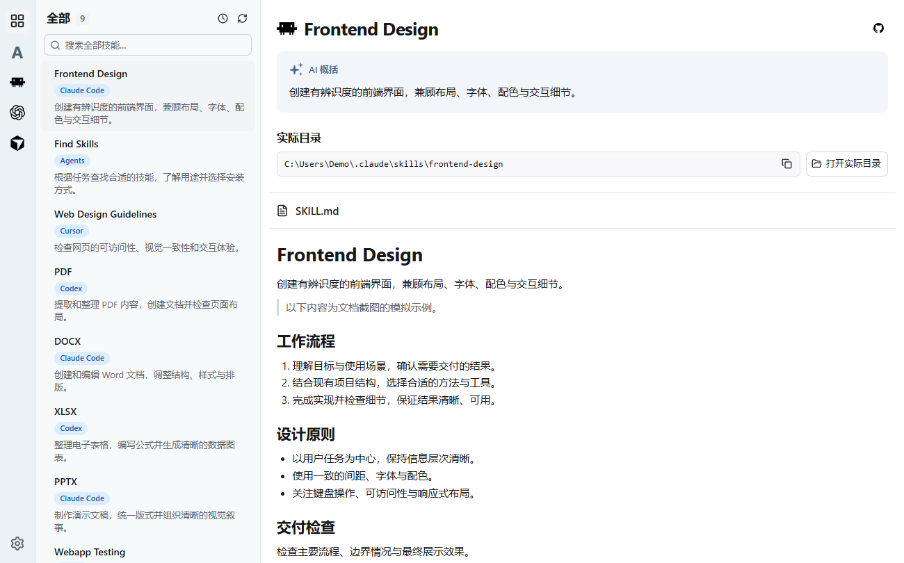
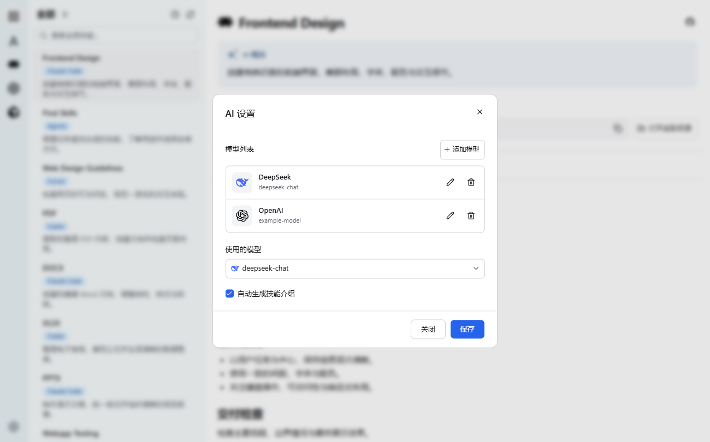

<p align="center">
  
</p>

<h1 align="center">Skills Manager</h1>

<p align="center">
  <strong>Browse local skills for Claude Code, Codex, Cursor, and other AI agents in one place. Search skills, read their instructions, and generate short Chinese summaries with AI.</strong>
</p>

<p align="center">
  
  
  <a href="LICENSE"></a>
</p>

<p align="center"><a href="README.md">简体中文</a> · English</p>

## Features

- **Browse in one place**: Filter installed skills by agent, search them, and read their full instructions.
- **Chinese summaries**: Connect your own AI model to automatically generate short Chinese descriptions of each skill.
- **Find the source**: Open a skill's local folder or visit its identified source repository using the GitHub icon.

<p align="center">
  
</p>

All screenshots use mock data. Skill descriptions and instructions are for demonstration only.

## Download and use

A portable app for **Windows**. No Node.js or Rust installation is needed.

1. Go to [Releases](https://github.com/churjan/skills-manager/releases) and download `skills-manager.exe` from the latest release's **Assets**. Do not download the **Source code** archives.
2. Keep the file in a folder of your choice and double-click it to open Skills Manager (shown as “Skill 管理”). It automatically scans your installed skills.
3. Click an agent icon on the left to filter skills, or press `Ctrl+F` to search.
4. Select a skill to read its description and full instructions. Click “打开实际目录” (Open actual folder) to view its files.

After adding or removing skills, click the refresh button at the top right of the skill list to scan again. To update the app, close it and replace `skills-manager.exe` with the new version.

## Generate Chinese summaries

**To automatically generate short Chinese skill descriptions, first configure your own AI model and API key.**

1. Click the gear icon in the bottom left to open “AI 设置” (AI settings).
2. Click “添加模型” (Add model), choose a provider and model, and enter your API key. Click “测试模型” (Test model), then save after the test succeeds.
3. Choose “使用的模型” (Active model), enable “自动生成技能介绍” (Automatically generate skill descriptions), and click “保存” (Save).

Summaries are generated automatically and appear in the skill list and at the top of the detail view. Browsing, searching, and reading skills also work without configuring AI.

<p align="center">
  
</p>

## Notes

- WebView2 Runtime is required and is already available on most Windows PCs.
- The app follows your system proxy settings; no separate proxy setup is needed.
- Generating Chinese summaries sends skill content to your selected model provider. Usage charges depend on the provider's pricing.

<details>
<summary>Development and build</summary>

Requirements: Node.js and npm, the Rust MSVC toolchain, Visual Studio Build Tools with Desktop development with C++ and the Windows SDK, and WebView2 Runtime.

Run these commands from the repository root:

```powershell
npm ci
npm run desktop
```

| Command | Purpose |
| --- | --- |
| `npm run build` | Check TypeScript and build the frontend |
| `npm run test:repositories` | Run repository lookup tests |
| `cargo test --locked --manifest-path src-tauri/Cargo.toml` | Run backend tests |
| `npm run tauri -- build` | Build the portable Windows app |

The portable executable is written to `src-tauri/target/release/skills-manager.exe`. Upload this file when publishing a release.

</details>

## License

[MIT](LICENSE) · [Lobe Icons license](public/licenses/lobe-icons.txt)
