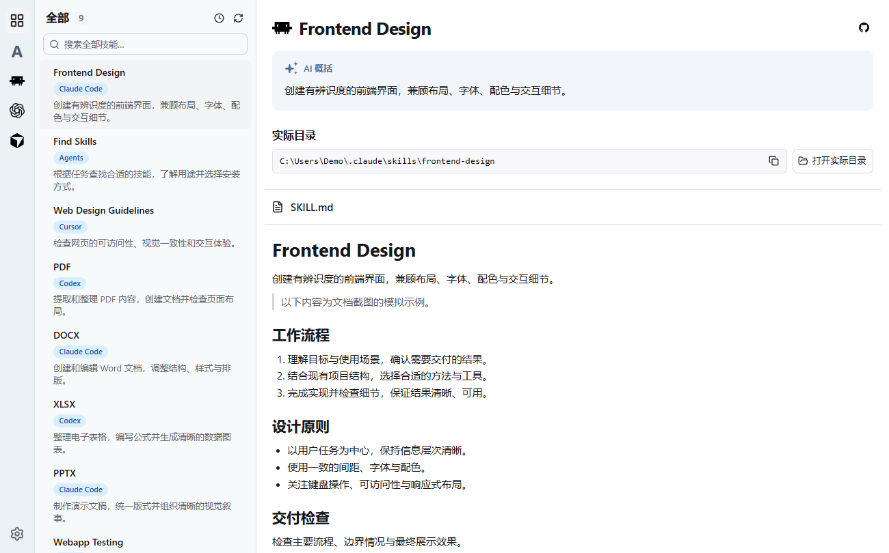
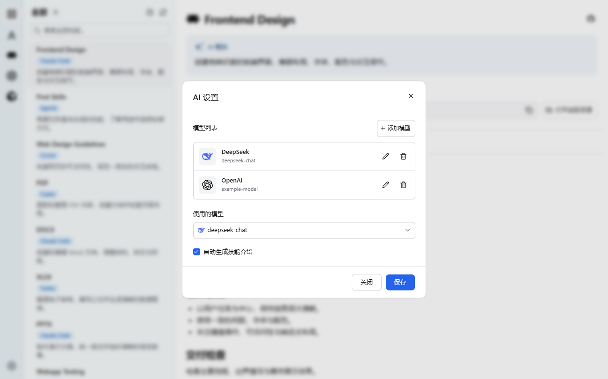

<p align="center">
  
</p>

<h1 align="center">Skills Manager</h1>

<p align="center">
  <strong>集中浏览 Claude Code、Codex、Cursor 等 Agent 的本地技能，支持搜索、说明查看和 AI 中文介绍。</strong>
</p>

<p align="center">
  
  
  <a href="LICENSE"></a>
</p>

<p align="center">简体中文 · <a href="README-en.md">English</a></p>

## 功能

- **集中查看**：按 Agent 筛选、搜索本机已安装的技能，直接阅读完整说明。
- **中文介绍**：配置 AI 模型后，自动为技能生成简短的中文介绍。
- **快速定位**：打开技能所在目录，或通过 GitHub 图标访问已识别的来源仓库。

<p align="center">
  
</p>

截图均使用模拟数据，技能介绍和正文仅作界面演示。

## 下载与使用

适用于 **Windows**，提供免安装版，无需安装 Node.js 或 Rust。

1. 前往 [Releases](https://github.com/churjan/skills-manager/releases)，在最新版本的 **Assets（附件）** 中下载 `skills-manager.exe`，请勿选择 **Source code** 源码包。
2. 将文件放到固定目录，双击打开「Skill 管理」，自动扫描本机已安装的技能。
3. 点击左侧 Agent 图标筛选来源，或按 `Ctrl+F` 搜索技能。
4. 点击技能查看介绍和完整说明，点击「打开实际目录」查看文件。

添加或移除技能后，点击列表右上角的刷新按钮重新扫描。更新客户端时，先关闭程序，再下载新版 `skills-manager.exe` 替换旧文件。

## 自动生成中文介绍

**想让技能自动显示简短的中文介绍？需要先配置自己的 AI 模型和 API Key。**

1. 点击左下角齿轮，打开「AI 设置」。
2. 点击「添加模型」，选择服务商和模型，填写 API Key；点击「测试模型」，通过后保存。
3. 选择「使用的模型」，勾选「自动生成技能介绍」，点击「保存」。

开启后会自动生成介绍，显示在技能列表和详情顶部。不配置 AI 也可以正常浏览、搜索和阅读技能。

<p align="center">
  
</p>

## 注意事项

- 运行需要 WebView2 Runtime，多数 Windows 电脑已自带。
- 客户端默认跟随系统代理设置，无需单独配置代理。
- 生成中文介绍时会将技能正文发送给所选模型服务商，调用费用按服务商规则计算。

<details>
<summary>开发与打包</summary>

需要 Node.js 和 npm、Rust MSVC 工具链、Visual Studio Build Tools（含 C++ 桌面开发和 Windows SDK），以及 WebView2 Runtime。

在仓库根目录执行：

```powershell
npm ci
npm run desktop
```

| 命令 | 用途 |
| --- | --- |
| `npm run build` | 检查 TypeScript 并构建前端 |
| `npm run test:repositories` | 运行仓库查询测试 |
| `cargo test --locked --manifest-path src-tauri/Cargo.toml` | 运行后端测试 |
| `npm run tauri -- build` | 构建 Windows 免安装版客户端 |

免安装版输出至 `src-tauri/target/release/skills-manager.exe`，发布 Release 时上传此文件。

</details>

## 许可

[MIT](LICENSE) · [Lobe Icons 许可](public/licenses/lobe-icons.txt)
